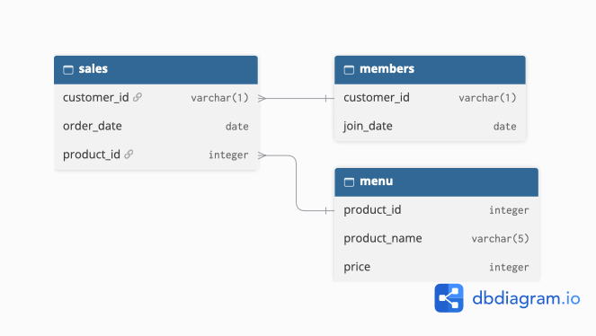

## Case 1: Danny's Diner

https://8weeksqlchallenge.com/case-study-1/

> sales table

| customer_id | order_date | product_id |
| ----------- | ---------- | ---------- |
| A           | 2021-01-01 | 1          |
| A           | 2021-01-01 | 2          |
| A           | 2021-01-07 | 2          |
| A           | 2021-01-10 | 3          |
| A           | 2021-01-11 | 3          |
| A           | 2021-01-11 | 3          |
| B           | 2021-01-01 | 2          |
| B           | 2021-01-02 | 2          |
| B           | 2021-01-04 | 1          |
| B           | 2021-01-11 | 1          |
| B           | 2021-01-16 | 3          |
| B           | 2021-02-01 | 3          |
| C           | 2021-01-01 | 3          |
| C           | 2021-01-01 | 3          |
| C           | 2021-01-07 | 3          |

> menu table

| product_id | product_name | price |
| ---------- | ------------ | ----- |
| 1          | sushi        | 10    |
| 2          | curry        | 15    |
| 3          | ramen        | 12    |

> members table

| customer_id | join_date  |
| ----------- | ---------- |
| A           | 2021-01-07 |
| B           | 2021-01-09 |
